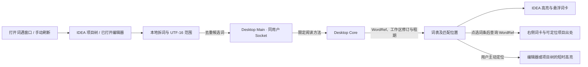

# IDEA 只读阅读架构

| 层次 | 负责内容 |
| --- | --- |
| IDEA 工具窗 | 连接与授权、自动和手动刷新、搜索筛选与排序、右侧词卡 |
| IDEA 设置 | 保存编辑器和项目树的持续高亮偏好，与底部工具窗共用 |
| 项目级 `ProjectEncounter` | 打开的文本与可见项目树快照、匹配代次、位置列表、范围标记和悬浮 |
| 安装级 `DesktopLinkService` | 发现、邀请、配对凭据、心跳及同一资料空间的连接恢复 |
| `DesktopClient` 与 `LmcpTransport` | LMCP 1.0.0 只读方法、帧长度与超时、响应身份和租期 |
| Desktop Main / Core | 独立传输身份、权限控制、工作区词条查询及公共词典内容 |

## 连接

同系统用户的 Desktop 资料根目录以权限受限的发现文件发布 socket 位置和独立 IDEA 握手密钥。Desktop Main 分配固定 IDEA 来源，保持 Browser Native Messaging 的来源校验。Main 与 Core 同时限定可调用的方法；IDEA 的业务会话仅有 `library:read`。发现与邀请不读取词库，用户确认后才签发只读会话。

IDEA 在自己的配置目录保存最小控制信息，文件为当前用户可读写。网络响应中不匹配连接、请求或工作区归属的结果会丢弃。临时失联时清除词表、词卡与标记，同一工作区可恢复配对。明确断开或撤权后需要重新授权。 [LMCP](https://github.com/leximeet/leximeet-connector-protocol)

## 匹配和显示

- 项目树读取展开且靠近视口的节点。编辑器读取已打开文件的可见文本及前后缓冲行。JAR 交给 IDE 自己打开，依赖库和 *class* 使用 IDEA 提供的展示。
- 候选词最多 500 个，100 个一批。保留单词原拼写处理同形身份。IDEA 提交词本身，桌面根据学习目标、收藏范围和词条身份给出命中。
- 工具窗可见且获得只读授权时启动自动匹配。文件改动、切换、视口变化或手动刷新使用同一条异步任务。刷新期间保留仍有权限的旧结果。收起窗口或失去连接后，当前任务及结果失效。
- 应用结果前复核项目代次、文档戳、Desktop 资料修订与租期。匹配和查词不阻塞 Swing 事件线程。
- 词表按单词和桌面词条身份合并位置，优先显示活动编辑器中的命中。定位前复核编辑器的文档戳与文本范围，或复核项目树路径与标签。重复点击在当前有效位置之间循环。
- 学习状态和标签来自同一批匹配响应。词表在本机组合搜索、状态及标签筛选，按列排序后通过模型中的行身份定位。词表加载期间只读取匹配数据，点选时读取详细词卡。
- 持续高亮使用安装级偏好，默认关闭。定位使用本轮位置快照为目标添加约两秒的短时高亮，搜索也只使用本轮结果。
- 下划线和树标签颜色跟随 IDE 明暗主题。右侧词卡在点选后按 WordRef 读取释义、音标及附件词典已有的词形与例句，切词或授权失效会丢弃旧响应。多个有效词条由用户选择。出处来自本机快照，可定位到准确代码行列或项目树项。
- 悬浮使用同一只读查询并显示简版卡片。工具窗、设置和两种词卡均使用 IDE 原生组件。

源码、路径和选区不进入网络请求，读取缓存只在内存。当前通过 macOS/Linux UDS 连接。Windows 绑定、全项目或归档索引后台扫描、采集与独立学习属于后续范围。
